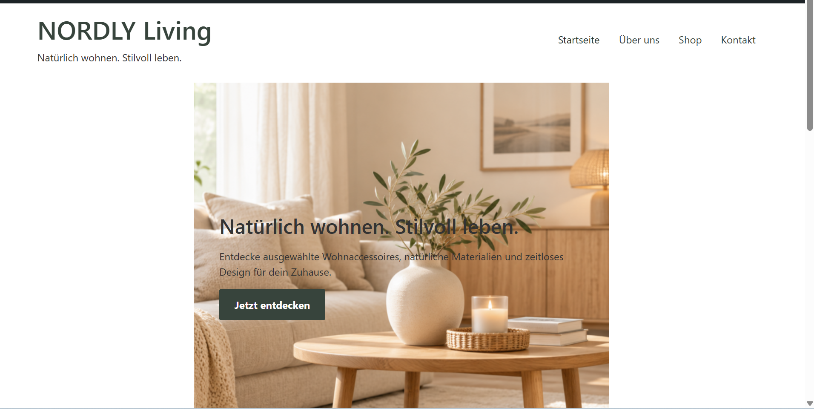
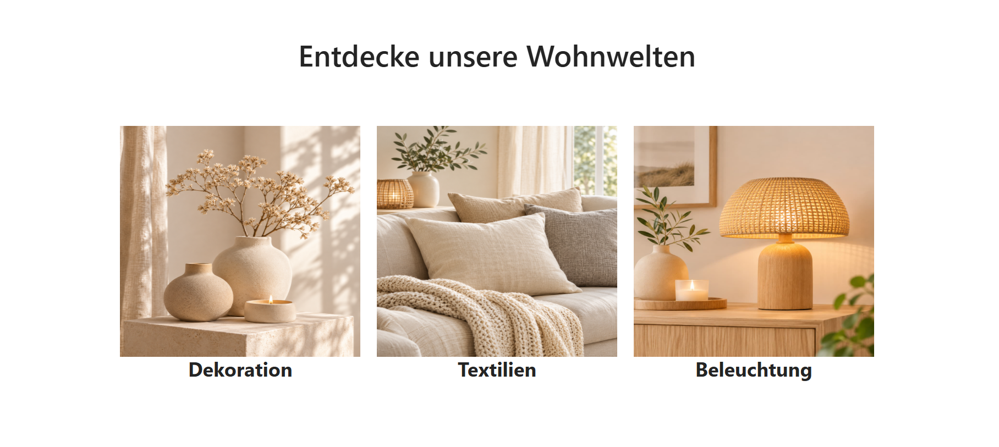
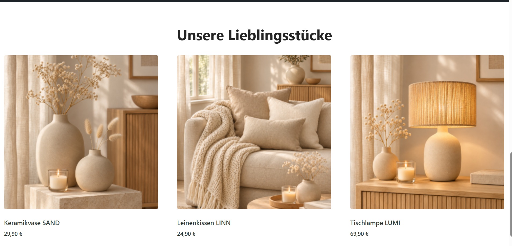
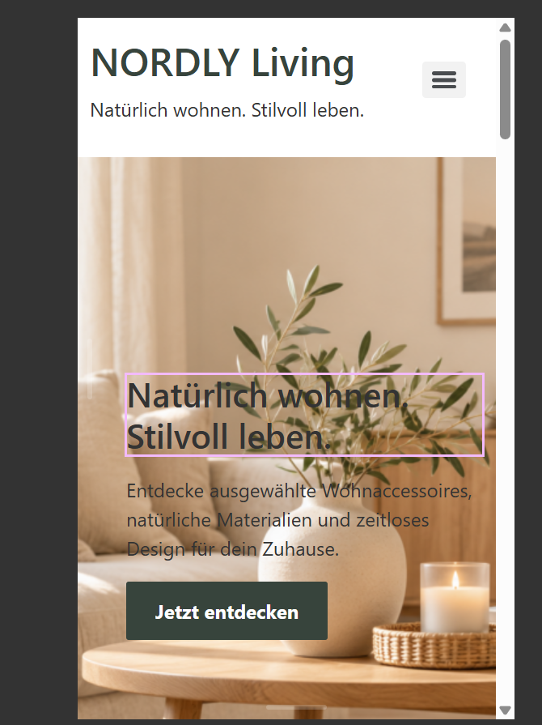

# NORDLY Living – WooCommerce Onlineshop

NORDLY Living ist ein fiktives E-Commerce-Demoprojekt
von MAVESSO.

Der Onlineshop wurde mit WordPress, WooCommerce und
Elementor umgesetzt und präsentiert ein modernes,
übersichtliches Einkaufserlebnis im Bereich Wohnen
und Einrichtung.

## Projektübersicht

- **Projekt:** NORDLY Living
- **Kategorie:** E-Commerce / Onlineshop
- **Technologien:** WordPress, WooCommerce, Elementor
- **Umsetzung:** Responsive Webdesign
- **Status:** Fiktives Demoprojekt

## Projektziele

Ziel war die Gestaltung eines modernen Onlineshops
mit einer klaren Seitenstruktur, ansprechenden
Produktpräsentationen und einer benutzerfreundlichen
Navigation.

Der Shop wurde für Desktop, Tablet und Smartphone
gestaltet.

## Screenshots

### Startseite

### Produktkategorien

### Produktübersicht

### Smartphone-Ansicht

## Technische Umsetzung

- WordPress als Content-Management-System
- WooCommerce für die Shop-Funktionen
- Elementor zur Gestaltung der Seiten
- Responsive Layouts für verschiedene Bildschirmgrößen
- Strukturierte Darstellung von Produkten und Kategorien

## Hinweis zum Projekt

NORDLY Living ist ein fiktives Portfolio-Projekt.

Der Onlineshop dient ausschließlich der
Demonstration von Webdesign- und
WooCommerce-Funktionen.

Es handelt sich nicht um einen öffentlich
betriebenen Shop mit echten Bestellmöglichkeiten.

## Entwickelt von MAVESSO

MAVESSO – Webdesign & Webentwicklung

E-Mail: info@mavesso.de
